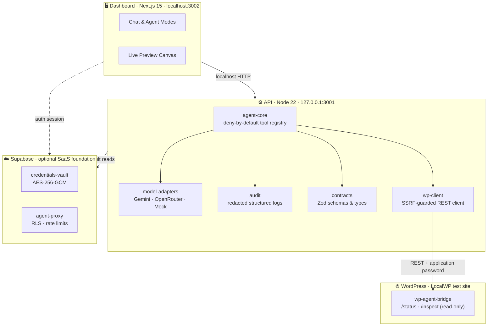
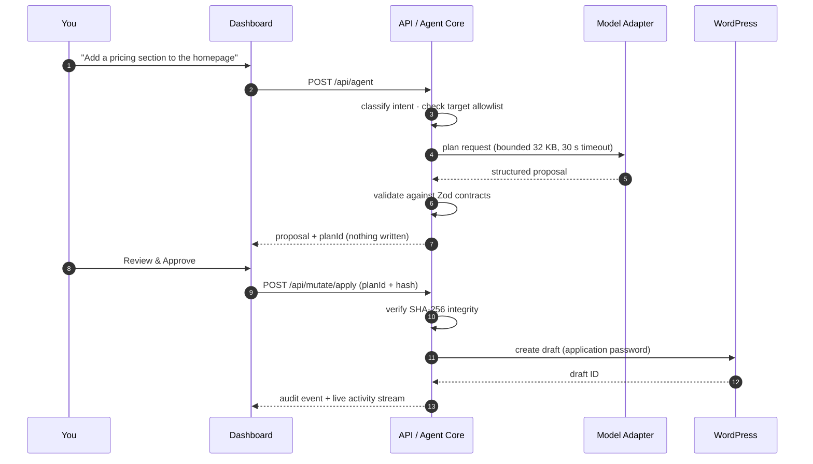

<div align="center">

# KPH SitePilot

### The AI copilot for WordPress — built on guardrails, not hope.

A local-first, provider-independent agent workspace that reads, plans, drafts and (only with your approval) writes to WordPress.

[](https://github.com/kanhajatthap/KPH-SitePilot/actions/workflows/ci.yml)
[](https://nodejs.org)
[](https://pnpm.io)
[](https://www.typescriptlang.org)
[](https://nextjs.org)
[](#quality-gates)
[](#security-model)
[](#roadmap)

**[Quick start](#quick-start)** · **[Architecture](#architecture)** · **[API](#api-reference)** · **[Security](#security-model)** · **[Docs](#documentation-index)**

</div>

---

> [!IMPORTANT]
> **KPH SitePilot never touches production WordPress.** Every connection is validated against a local-only allowlist (`*.local`, `localhost`, `127.0.0.1`). Credentials stay server-side, writes are draft-only, and every mutating action requires a human approval checkpoint.

## Why this exists

Most AI website builders ask you to trust a black box. KPH SitePilot takes the opposite position: **the model proposes, the system verifies, the human approves.** Every capability is bounded by a typed contract, an audit trail, and a deny-by-default registry — so the agent can be genuinely useful without ever being unsupervised.

**Formerly `wp-agent`** — the package namespaces (`@wp-agent/*`) are the historical identity and remain stable.

---

## At a glance

| | |
|---|---|
| **Product** | Conversational AI workspace for WordPress site building |
| **Architecture** | pnpm monorepo · Turborepo · TypeScript strict |
| **Apps** | `@wp-agent/dashboard` (Next.js 15 · React 19) · `@wp-agent/api` (Node 22) |
| **Packages** | 7 shared libraries + 2 apps, fully typed contracts |
| **Providers** | Google Gemini · OpenRouter · Mock (swap without touching business logic) |
| **Persistence** | Local-only by default · optional Supabase SaaS foundation |
| **Writes** | Draft-only, SHA-256 locked, human-approved |
| **Tests** | 260+ cases across 37 suites · zero-quota mock mode |
| **CI** | Typecheck → lint → secret scan → audit → tests → build |

---

## Table of contents

- [Design principles](#design-principles)
- [Feature matrix](#feature-matrix)
- [Architecture](#architecture)
- [Repository layout](#repository-layout)
- [Quick start](#quick-start)
- [Configuration](#configuration)
- [API reference](#api-reference)
- [The safety pipeline](#the-safety-pipeline)
- [Security model](#security-model)
- [Quality gates](#quality-gates)
- [Roadmap](#roadmap)
- [Documentation index](#documentation-index)
- [Contributing](#contributing)

---

## Design principles

> Five rules that decide every trade-off in this codebase.

| # | Principle | What it means in practice |
|---|-----------|---------------------------|
| 01 | **Deny by default** | Unknown tools, unknown providers and unknown targets fail closed with a structured error — never "best effort". |
| 02 | **Provider independence** | `ModelAdapter` is the only seam the agent knows. Gemini, OpenRouter and Mock are interchangeable at runtime. |
| 03 | **Human in the loop** | The model can *propose*. It cannot *approve*. Mutations require an explicit apply step, bound to a plan ID and integrity hash. |
| 04 | **Local first** | No production host, no cloud round-trip, no leaked keys. The whole workflow runs against a LocalWP instance on `127.0.0.1`. |
| 05 | **Evidence over claims** | Every phase ships with an acceptance report containing real command output — not "should work". |

---

## Feature matrix

### Agent & orchestration

| Capability | Description |
|---|---|
| 🧠 **Intent detection** | Classifies natural-language requests into read / plan / mutate / publish intents before any tool runs. |
| 🗂️ **Task engine** | Plans multi-step work, executes sequentially, and streams live activity to the dashboard over SSE. |
| 🛡️ **Tool registry** | Read-only tools (`site.inspect`, `page.read`) ship enabled; everything else must be explicitly proposed and approved. |
| 🔁 **Revision loop** | Drafts and plans can be revised conversationally without losing the audit trail. |

### Site building

| Capability | Description |
|---|---|
| 🎨 **Design system planner** | Generates structured site plans: information architecture, sections, type scale, color roles and layout direction. |
| 🧱 **Builder detection** | Detects Gutenberg, Elementor, ACF, WooCommerce, FSE themes and available namespaces on the target site. |
| 📝 **Draft creation** | Creates WordPress posts **as drafts only**, with duplicate detection and an integrity hash. |
| 🚀 **Publish approval** | A separate propose → review → apply flow, so "publish" is never a side effect of "generate". |
| 🧩 **Native integrations** | Builder-native output for Gutenberg blocks, Elementor widgets, ACF fields, WooCommerce data and theme.json. |

### Platform

| Capability | Description |
|---|---|
| 🔐 **Audit engine** | Recursive redaction of passwords, bearer tokens, WP application passwords, and `sk-or-v1-*` / `AIzaSy*` / `gsk_*` keys. |
| 🗄️ **Credentials vault** | AES-256-GCM at rest, 96-bit random IVs, decrypt endpoints that simply do not exist. |
| ☁️ **Optional SaaS layer** | Supabase Auth + RLS + Edge Functions; hosted mode stays fail-closed until a per-connection bridge exists. |
| ⚙️ **Validated config** | Zod-validated environment loading with safe defaults and loud, structured failures. |

---

## Architecture



### Request lifecycle



> [!NOTE]
> The model never holds a WordPress credential, never sees an application password, and cannot move a post out of `draft` — by construction, not by prompt.

---

## Repository layout

```text
KPH-SitePilot/
├── apps/
│   ├── api/                     # Node 22 HTTP server · 127.0.0.1:3001
│   └── dashboard/               # Next.js 15 workspace · localhost:3002
├── packages/
│   ├── contracts/               # Shared types, Zod schemas, structured errors
│   ├── config/                  # Validated environment loading
│   ├── model-adapters/          # Gemini · OpenRouter · Mock providers
│   ├── agent-core/              # Orchestration, tool registry, task engine
│   ├── wp-client/               # Read-only REST client + SSRF allowlist
│   ├── audit/                   # Redacted structured audit logger
│   └── supabase/                # SaaS foundation, vault, RLS helpers
├── supabase/
│   ├── functions/               # agent-proxy · credentials-vault (Deno)
│   ├── migrations/              # SaaS schema + RLS policies
│   └── tests/database/          # RLS verification SQL
├── wordpress/
│   └── wp-agent-bridge/         # Companion plugin (/status, /inspect)
├── docs/                        # ADRs, runbooks, acceptance reports
├── tests/                       # Tiered testing runbook
├── .github/workflows/ci.yml     # Typecheck → lint → secret scan → test → build
├── AGENTS.md                    # Always-active workspace agent rules
├── turbo.json                   # Task pipeline & caching
└── tsconfig.base.json           # Shared strict TypeScript config
```

---

## Quick start

**Prerequisites** — Windows 11 · PowerShell 7+ · Node 22 LTS · pnpm 12 · Git 2.54+ · LocalWP with PHP 8.2 (for the WordPress side).

### 1 · Install

```powershell
corepack enable pnpm
pnpm install
```

### 2 · Configure

```powershell
Copy-Item .env.example .env.local
```

Then edit `.env.local` — see [Configuration](#configuration).

### 3 · Build

```powershell
pnpm build
```

### 4 · Run (two terminals)

```powershell
# Terminal 1 — API on 127.0.0.1:3001
pnpm start:api

# Terminal 2 — Dashboard on localhost:3002
pnpm dev:dashboard
```

Open **http://localhost:3002**.

### 5 · Verify

```powershell
# Health
Invoke-RestMethod http://127.0.0.1:3001/health | ConvertTo-Json

# Chat with the configured model
$body = @{ prompt = "Reply with: hello from SitePilot" } | ConvertTo-Json
Invoke-RestMethod -Uri http://127.0.0.1:3001/api/chat -Method Post `
  -ContentType application/json -Body $body | ConvertTo-Json
```

<details>
<summary><strong>Expected health response</strong></summary>

```json
{
  "status": "ok",
  "service": "kph-sitepilot-api",
  "version": "0.1.0",
  "timestamp": "2026-10-23T..."
}
```
</details>

---

## Configuration

| Variable | Default | Scope | Purpose |
|---|---|---|---|
| `PORT` | `3000` | server | Application server port |
| `NODE_ENV` | `development` | server | Runtime mode |
| `LOG_LEVEL` | `info` | server | Log verbosity |
| `WP_SITE_URL` | `http://plugin-test.local` | server | Local WordPress target (allowlisted) |
| `WP_APPLICATION_USERNAME` | — | server | WordPress user with an application password |
| `WP_APPLICATION_PASSWORD` | — | server | **Revocable** application password — never your admin login |
| `AI_PROVIDER` | `mock` | server | `mock` · `gemini` · `openrouter` |
| `AI_MODEL` | `mock-model` | server | Default model identifier |
| `GEMINI_API_KEY` | — | server only | Google AI Studio key |
| `GEMINI_MODEL` | `gemini-3.8-flash` | server only | Gemini model |
| `OPENROUTER_API_KEY` | — | server only | OpenRouter key |
| `OPENROUTER_MODEL` | `minimax/minimax-m3.1-flash:free` | server only | OpenRouter model |
| `NEXT_PUBLIC_SUPABASE_URL` | — | dashboard | Enables hosted SaaS mode when set |
| `NEXT_PUBLIC_SUPABASE_ANON_KEY` | — | dashboard | **Anon/publishable key only** |
| `SUPABASE_SERVICE_ROLE_KEY` | — | Edge Functions | Never exposed to the dashboard |
| `VAULT_MASTER_KEY` | — | Edge Functions | AES-256-GCM vault master key |

> [!NOTE]
> The API host is hard-locked to `127.0.0.1`. The schema default is port `3000`; this workspace's `.env.local` uses `PORT=3001`, which is why the examples above point at `:3001`. Change one or the other — not both.

> [!WARNING]
> `.env.local` is git-ignored and must never be committed or logged. Service-role, vault and provider secrets must never appear in any `NEXT_PUBLIC_*` variable.

---

## API reference

All endpoints bind to **`127.0.0.1`** and accept JSON. Legacy short paths (`/chat`, `/agent`, …) remain as aliases.

### Core

| Method | Endpoint | Purpose |
|---|---|---|
| `GET` | `/health` | Service status and version |
| `POST` | `/api/chat` | Direct model chat (no site access) |
| `POST` | `/api/agent` | Orchestrated agent run (read-only by default) |
| `POST` | `/api/agent/intent` | Intent classification only |

### Planning & tasks

| Method | Endpoint | Purpose |
|---|---|---|
| `POST` | `/api/plan` | Structured site plan + design system |
| `POST` | `/api/task/plan` | Multi-step task planning |
| `POST` | `/api/task/execute` | Execute an approved task plan |
| `GET` | `/api/task/stream` | Server-sent live activity stream |

### Content

| Method | Endpoint | Purpose |
|---|---|---|
| `POST` | `/api/mutate/propose` | Propose a draft post (duplicate check + hash) |
| `POST` | `/api/mutate/apply` | Create the approved draft |
| `POST` | `/api/draft/revise` | Revise a draft conversationally |
| `POST` | `/api/post/get` | Fetch a post for preview |
| `POST` | `/api/publish/propose` | Propose publishing an existing draft |
| `POST` | `/api/publish/apply` | Apply the approved publish action |

### Builders & site

| Method | Endpoint | Purpose |
|---|---|---|
| `POST` | `/api/builder/detect` | Detect Gutenberg / Elementor / ACF / Woo / FSE |
| `POST` | `/api/builder/propose` | Propose builder-native content |
| `POST` | `/api/site/settings/propose` | Propose site settings changes |
| `POST` | `/api/site/settings/apply` | Apply approved settings |
| `GET` | `/api/site/plugins/list` | List installed plugins |
| `POST` | `/api/site/plugins/propose` | Propose plugin operation |
| `POST` | `/api/site/plugins/apply` | Apply approved plugin operation |
| `POST` | `/api/site/code/propose` | Propose a code injection |
| `POST` | `/api/site/code/apply` | Apply approved injection |
| `POST` | `/api/site/pages/propose` | Propose a page creation |
| `POST` | `/api/site/pages/apply` | Create the approved page |

---

## The safety pipeline

```text
  prompt
    │  intent classification
    ▼
  plan ──────────► Zod contract validation
    │                    │
    │                    ▼
    │              SHA-256 integrity hash
    ▼                    │
  proposal ◄─────────────┘
    │  human review in dashboard
    ▼
  apply ──► re-verify hash ──► draft-only write ──► audit event
```

Every stage is independent: a proposal can be rejected, a hash mismatch aborts the write, and a write is always recorded as a redacted audit event.

---

## Security model

| Layer | Control |
|---|---|
| **Network** | API binds to `127.0.0.1`; WordPress targets must match `*.local`, `localhost` or `127.0.0.1`. SSRF is blocked at the client. |
| **Identity** | WordPress application passwords only — revocable, scoped, never the admin password. |
| **Authorization** | Deny-by-default tool registry; unknown tools fail closed with `AgentError`. |
| **Approval** | Mutations require a plan ID **and** a verified SHA-256 hash; AI cannot self-approve. |
| **Write scope** | New content is created as `draft`; publish is a separate, explicit flow. |
| **Secrets** | Server-side only. AES-256-GCM vault with 96-bit IVs. No decrypt-to-browser endpoint exists. |
| **Observability** | Recursive redaction of passwords, `Basic`/`Bearer` tokens, WP app passwords, and provider key patterns. |
| **Supply chain** | CI blocks committed `.env` files, runs `pnpm audit --prod --audit-level high`, and pins the pnpm lockfile. |

> [!TIP]
> The full OWASP Top 10 for LLM Applications matrix — including excessive agency, prompt injection and approval replay — lives in [`docs/security-review.md`](./docs/security-review.md).

---

## Quality gates

```powershell
pnpm typecheck     # strict TS across all packages + Edge Functions
pnpm lint          # static analysis (zero-tolerance)
pnpm test          # 260+ tests, mock mode, zero quota, zero network
pnpm build         # Turborepo build across the workspace
```

| Suite | Command | Network |
|---|---|---|
| Unit & security | `pnpm test` | ❌ none (MockAdapter) |
| Type safety | `pnpm typecheck` | ❌ |
| Live Gemini (1 request) | `pnpm test:live` | ✅ opt-in |
| Live WordPress read | `pnpm test:wp:live` | ✅ auto-skips if site is down |
| WordPress plugin | `php wordpress/wp-agent-bridge/tests/test-plugin.php` | ❌ |

The same gates run in CI on every push and pull request to `main`.

---

## Roadmap

| Phase | Scope | Status |
|---|---|:---:|
| **1** | Read-only foundation: contracts, audit, SSRF-guarded client, bridge plugin | ✅ |
| **2A** | Gemini provider, `/api/chat`, provider-independent adapters | ✅ |
| **2B** | Tool loop inside the agent with approval checkpoints | ⏳ next |
| **4** | Site planner, design system engine, preview canvas | ✅ |
| **5** | Controlled WordPress writes (draft-only, hash-locked) | ✅ |
| **6** | Builder integrations: Gutenberg, Elementor, ACF, WooCommerce, FSE | ✅ |
| **7** | Supabase SaaS foundation: auth, RLS, vault, rate limits | ✅ local · ☁️ hosted gated |
| **8** | Security review, OWASP LLM matrix, release readiness | ✅ |

---

## Documentation index

| Document | What it answers |
|---|---|
| [`docs/architecture-decisions.md`](./docs/architecture-decisions.md) | Why the system is shaped this way (ADRs) |
| [`docs/environment-setup.md`](./docs/environment-setup.md) | Verified toolchain inventory and setup record |
| [`docs/deployment-guide.md`](./docs/deployment-guide.md) | Production deployment prerequisites |
| [`docs/security-review.md`](./docs/security-review.md) | OWASP LLM Top 10 matrix and findings |
| [`docs/release-checklist.md`](./docs/release-checklist.md) | Pre-release security & readiness gates |
| [`docs/backup-restore-strategy.md`](./docs/backup-restore-strategy.md) | Backup, restore and disaster recovery |
| [`docs/incident-response-and-rollback.md`](./docs/incident-response-and-rollback.md) | Severity levels, response and rollback runbook |
| [`docs/capability-coverage-audit.md`](./docs/capability-coverage-audit.md) | Capability audit and end-to-end verification |
| [`docs/phase-1-acceptance.md`](./docs/phase-1-acceptance.md) · [`4`](./docs/phase-4-acceptance.md) · [`5`](./docs/phase-5-acceptance.md) · [`6`](./docs/phase-6-acceptance.md) · [`7`](./docs/phase-7-acceptance.md) · [`8`](./docs/phase-8-acceptance.md) | Phase acceptance evidence |
| [`docs/full-e2e-qa-acceptance-report.md`](./docs/full-e2e-qa-acceptance-report.md) | Full end-to-end QA report |
| [`tests/README.md`](./tests/README.md) | Tiered testing architecture |

---

## Contributing

1. **Read the rules** — [`AGENTS.md`](./AGENTS.md) defines the workspace constraints (security-first, read-only by default).
2. **Branch** — `feat/…`, `fix/…`, `docs/…`.
3. **Gate before pushing** — `pnpm typecheck && pnpm lint && pnpm test`.
4. **Never commit** `.env.local`, credentials, or provider keys. CI will reject it.
5. **Document evidence** — mutating changes need an acceptance note in `docs/`.

---

<div align="center">

**KPH SitePilot** · built to be trusted, not just demoed.

<sub>Local-first · Provider-independent · Human-approved</sub>

</div>
