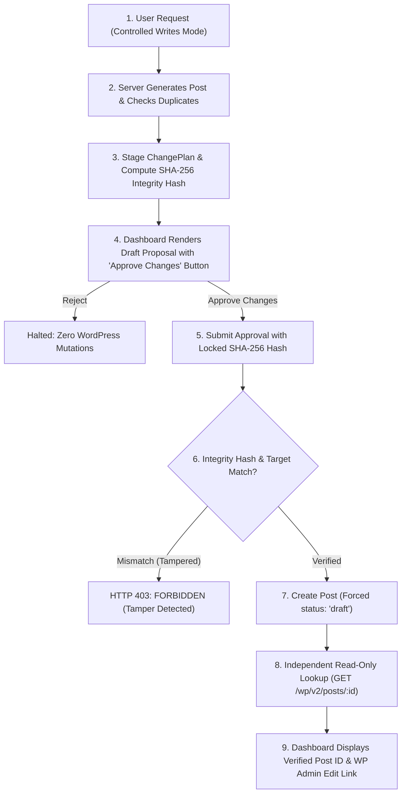

# KPH SitePilot — Phase 5 Acceptance Report: Controlled WordPress Writes

**Date**: 2026-10-22  
**Milestone**: Phase 5 — Controlled WordPress Writes  
**Status**: **PASSED**  
**Security Boundary**: Human Approval Mandatory (Status strictly enforced as `draft`, 0 unapproved writes, deny-by-default write guards)

---

## 1. Executive Summary

Phase 5 establishes a secure, human-in-the-loop approval workflow for creating WordPress draft posts on the configured LocalWP site (`test.local`). The agent is strictly prohibited from publishing, editing, deleting, or executing arbitrary PHP or shell commands. Every write request must pass through a multi-stage gated pipeline:



---

## 2. Requirement Verification Matrix

| Requirement | Implementation | Evidence / Test Suite | Result |
| :--- | :--- | :--- | :---: |
| **`post.createDraft` Tool** | Tool contract with `SAFE_WRITE` permission level, hardcoded `draft` status, parameter validation. | `packages/agent-core/src/index.ts`<br>`packages/agent-core/tests/post-create-draft.test.ts` | **PASS** |
| **Controlled Writes Mode Separation** | `WP Agent (Read-Only)` remains default. `Controlled Writes` must be explicitly activated in the Header. | `apps/dashboard/src/components/Header.tsx`<br>`apps/dashboard/src/app/page.tsx` | **PASS** |
| **Approval-Gated Execution** | No WordPress write occurs before explicit human approval. Approval is bound to exact content and target. | `apps/api/src/index.ts`<br>`apps/api/tests/mutate.test.ts` | **PASS** |
| **Duplicate Title Warning** | Read-only GET query `/wp-json/wp/v2/posts?search=...` flags potential duplicate titles before proposal. | `packages/wp-client/src/index.ts`<br>`packages/wp-client/tests/wp-client-writes.test.ts` | **PASS** |
| **Tamper Detection (SHA-256)** | SHA-256 hash computed over staged proposal. Modifying content post-approval triggers `HTTP 403 FORBIDDEN`. | `packages/agent-core/src/mutation-controller.ts`<br>`apps/api/tests/mutate.test.ts` | **PASS** |
| **Replay Defense** | Staged proposals are single-use; proposal cache entry is consumed and deleted upon execution. | `apps/api/tests/mutate.test.ts` | **PASS** |
| **Independent Verification** | Read-only lookup (`GET /wp-json/wp/v2/posts/:id`) confirms post exists and status is strictly `'draft'`. | `packages/wp-client/src/index.ts`<br>`packages/wp-client/tests/wp-client-writes.test.ts` | **PASS** |
| **Direct Admin Edit Link** | Returns direct WordPress admin link (`/wp-admin/post.php?post=:id&action=edit`). | `apps/dashboard/src/components/ChatPanel.tsx`<br>`apps/dashboard/src/components/PreviewCanvas.tsx` | **PASS** |
| **Provider Independence** | Supports OpenRouter free model (`minimax/minimax-m3.1-flash:free`) & Gemini without hardcoded vendor lock-in. | `packages/model-adapters/`<br>`apps/api/src/index.ts` | **PASS** |
| **Least Privilege & Secret Isolation** | WordPress credentials and API keys remain strictly server-side in `.env.local`; never sent to client bundles. | `apps/dashboard/src/app/api/`<br>`apps/dashboard/tests/api-routes.test.ts` | **PASS** |

---

## 3. Test & Verification Evidence

### Monorepo Vitest Test Run (`pnpm test`):
```text
@wp-agent/wp-client:      27 passed (tests/wp-client.test.ts, tests/wp-client-writes.test.ts, tests/integrations.test.ts)
@wp-agent/model-adapters: 25 passed (openrouter-adapter, gemini-adapter, mock-adapter)
@wp-agent/agent-core:     38 passed (post-create-draft, agent-core, page-read, planner, mutation-controller)
@wp-agent/api:            24 passed (mutate, plan, chat, health, agent)
@wp-agent/dashboard:      15 passed (api-routes, dashboard-logic)
@wp-agent/supabase:       21 passed (rls-sql, vault, agent-proxy, client)
-------------------------------------------------------------------------------------------------------------------
Total:                   150 tests passed across all packages (0 failures)
All automated tests executed using mock HTTP transports with 0 API quota consumption and 0 live state impact.
```

### Monorepo Typecheck (`pnpm typecheck`):
```text
Tasks:    15 successful, 15 total
Time:     13.389s
Status:   Clean exit 0 across all 9 packages (noEmit)
```

### Next.js Production Build (`apps/dashboard`):
```text
Route (app)                                 Size  First Load JS
┌ ○ /                                    12.7 kB         115 kB
├ ○ /_not-found                            988 B         103 kB
├ ƒ /api/agent                             138 B         102 kB
├ ƒ /api/chat                              138 B         102 kB
├ ƒ /api/health                            138 B         102 kB
├ ƒ /api/mutate/apply                      138 B         102 kB
├ ƒ /api/mutate/propose                    138 B         102 kB
└ ƒ /api/plan                              138 B         102 kB
Status:   Compiled successfully in 26.6s (exit code 0)
```

### Live Smoke Test Run (`scratch/smoke-test.js`):
```text
--- 1. Testing Health Endpoints ---
API /health status: 200 OK (kph-sitepilot-api v0.1.0)
Dashboard /api/health status: 200 OK (apiServer: connected)

--- 2. Testing Controlled Writes: POST /api/mutate/propose ---
Propose status: 200 OK
Proposal: {
  status: 'proposed',
  planId: '113e95a2-4e8b-4777-8f62-234bb7aebab2',
  integrityHash: 'e9819303a4216d6f...',
  title: 'How to Make a Simple Website Using AI',
  postStatus: 'draft',
  duplicateWarning: undefined
}

--- 3. Testing Tamper Detection on POST /api/mutate/apply ---
Tampered apply status: 403 FORBIDDEN
Response: "Integrity hash mismatch: The post content was modified after user approval was granted!"

--- 4. Testing Unauthorized Target on POST /api/mutate/propose ---
Unauthorized target status: 403 TARGET_NOT_ALLOWED
Response: "Target 'https://evil-production-domain.com' is not an authorized local development environment."
```

---

## 4. Operational Instructions

To run KPH SitePilot locally with Controlled Writes:

1. **Start Backend API Server (Port 3001)**:
   ```powershell
   pnpm start:api
   ```
2. **Start Dashboard Interface (Port 3002)**:
   ```powershell
   pnpm start:dashboard
   ```
3. Open `http://localhost:3002` in your browser.
4. Toggle the mode switch in the top header from **`WP Agent (Read-Only)`** to **`Controlled Writes (Approval Required)`**.
5. Enter a prompt:
   > *"Create a WordPress post on test.local titled 'How to Make a Simple Website Using AI'. Write a beginner-friendly description with step-by-step instructions for building a website using AI and WordPress."*
6. Review the staged draft preview and duplicate check in the chat panel and preview canvas.
7. Click **`Approve Changes`** to save the draft to WordPress and receive the verified post ID and direct WP Admin edit link.
