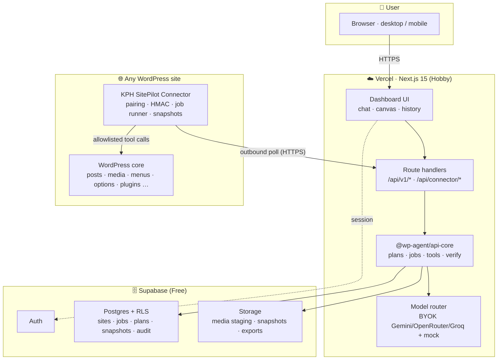

# KPH SitePilot — “Lovable for WordPress” Master Plan (A → Z)

> **Status:** executing · 2026-11-02 · M0 ✅ · M1 ✅ (auth, quotas, cron, health) · M2 in progress (pairing + job pipeline live) · M3 in progress (plan → approve → execute → undo shipped)
> **Blocked on the owner:** auth email delivery (custom SMTP + Supabase project access) — see [`docs/email-deliverability.md`](./email-deliverability.md)
> **Owner:** Kanha Jatthap · **Executor:** Arena agent + owner
> **Scope:** turn KPH SitePilot into a free-tier, hosted, connect-any-WordPress product where the
> entire WordPress admin can be driven by prompts, safely and reversibly.
> **Backlog:** [`docs/sitepilot-backlog.md`](./sitepilot-backlog.md) · **Progress log:** [`docs/plan-progress.md`](./plan-progress.md)

---

## 0. TL;DR (Hinglish)

Aaj ka project ek **strong safety skeleton + local demo** hai — real “Lovable for WordPress” nahi.
Build green hai, tests 330 pass / 1 fail, par **Vercel pe deployed dashboard bekaar hai** (env vars zero,
API `127.0.0.1:3001` dhoondhta hai) aur **Supabase project bilkul khaali hai** (0 migration, 0 table,
0 edge function). WordPress side pe sirf ek **read-only bridge plugin** (2 endpoints) hai aur site list
dashboard me **hardcoded** hai.

Plan ka core:

1. **Connector plugin** (`kph-sitepilot-connector`) — site se **outbound** cloud se baat karega
   (pairing code → HMAC-signed job pull). Isse na app-password chahiye, na inbound port, na firewall issue.
2. **Platform** — Next.js on Vercel + Supabase (Auth/DB/Storage) + **BYOK free AI key**. Node API ki logic
   `@wp-agent/api-core` package me nikal kar Vercel route handlers se chalayenge (local dev me wahi Node server).
3. **Tool layer v2** — ~130 tools ka catalog (content, media, menus, settings, plugins, users, SEO, perf,
   security, backup, WooCommerce…) risk-level + snapshot + dry-run ke saath.
4. **Har change ka pipeline** — prompt → plan → diff → approve → job → apply → **read-back verify** → **undo**.
5. **Lovable-class UX** — projects, chat, live preview, versions, activity, mobile.
6. **$0/month** — Vercel Hobby + Supabase Free + GitHub + free AI key + GitHub-release ZIP plugin.

Delivery: **M0 → M6**, ~8–10 weeks solo, har micro-task ID ke saath (`E0-01` … `E12-xx`).

> ⚠️ Session rule: main branch par direct push is environment me allowed nahi hai. Har step
> `arena/d0d25bf5-kph-sitepilot` branch par commit + push hoga, aur aap ek click me PR merge kar sakte hain.
> Har step ke baad `docs/plan-progress.md` update hoga (evidence ke saath).

---

## 1. Audit — aaj project actually kya hai

### 1.1 Repo + toolchain (re-run in this workspace)

| Check | Command | Result |
|---|---|---|
| Install | `pnpm install --frozen-lockfile` | ✅ 196 packages, 3.7 s |
| Build | `pnpm build` | ✅ **9/9 tasks successful**, 50.7 s (dashboard: 20 routes) |
| Tests | `pnpm -r --workspace-concurrency=1 test` | ⚠️ **330 passed, 1 failed** |
| API tests | `pnpm --filter @wp-agent/api test` | ✅ 54/54 |
| Plugin lint | `php -l wordpress/wp-agent-bridge/wp-agent-bridge.php` | (run in M0) |

**Failing test (real, pre-existing):**
`packages/agent-core/tests/workspace-task-engine.test.ts` → *“transitions to waiting_for_approval during
Controlled Writes planning”* — expected `waiting_for_approval`, got `failed`.

**Fresh-clone trap:** `pnpm -r test` (what CI runs) fails before a build, because package `dist/` is missing
(`Failed to resolve entry for package "@wp-agent/contracts"`). `turbo.json` correctly declares
`test.dependsOn: ["^build"]`, but CI bypasses Turbo with `pnpm -r test`. **CI is red on `main`**
(GitHub run `40459112881`, 58 s).

### 1.2 Deployment reality (checked live)

| Surface | Reality |
|---|---|
| **Vercel** | Project `kph-sitepilot` exists · Hobby · root `apps/dashboard` · prod alias `kph-sitepilot.vercel.app` · READY · **`env: []` (zero environment variables)** · git auto-deploy disabled |
| **Supabase** | Project `zgkewnhrymswhucigtib` (ap-south-1) · healthy · **migrations: none · public tables: none · edge functions: none** |
| **Consequence** | Hosted dashboard runs in “local-first” mode with no auth, and every API call proxies to `http://127.0.0.1:3001`, which does not exist on Vercel → **hosted product cannot work today** |

### 1.3 Code reality

| Area | What exists | Gap for the product |
|---|---|---|
| API | `apps/api` Node HTTP server, 2768 lines, 30+ routes, binds hard-coded `127.0.0.1` (line 2751) | Vercel undeployable; single global WP credential; no job queue; in-memory task state |
| WP client | SSRF-guarded REST client; local-only allowlist (`*.local`, `localhost`, `127.0.0.1`) enforced in *both* client and dashboard proxy | Cannot connect a real remote site; no per-site credentials; no inbound-call model |
| Site manager | Windows/LocalWP WP-CLI with hard-coded paths (`C:\Users\india`, `Local Sites\test`) | Not portable, not hosted, not multi-tenant |
| Bridge plugin | `wp-agent-bridge` v0.1.0 — 2 read-only endpoints (`/status`, `/inspect`) | No pairing, no auth token, no job execution, no writes |
| Agent | Intent detection, planner, task engine, mutation controller (SHA-256 + approval + in-memory rollback) | Only 4 tool contracts; no real tool loop; state lost on restart |
| Contracts | 7 change-operation types; strong Zod schemas | Missing media/menus/users/SEO/Woo/backup/update domains |
| Dashboard | Next.js 15, 17 API proxy routes, chat + preview + approval cards | Sites hard-coded (`test.local`, `plugin-test.local`), no connect flow, no persistence, no undo |
| Supabase | Good multi-tenant schema design in SQL (RLS, vault, rate limit RPC) | Never applied to the live project; `wordpress_connection_metadata` view is design-only until migration runs |
| CI | typecheck → lint → secret scan → tests → build | Tests run before build (fails on clean checkout); main is red |

### 1.4 Blunt verdict

**Score vs “Lovable for WordPress”: 35 / 100.**

- ✅ Safety thinking, contracts, audit redaction, approval/hash model — genuinely good bones.
- ⚠️ Local demo works; hosted product does not exist yet.
- ❌ No connector, no multi-site, no media, no menus, no users, no WooCommerce, no SEO writes, no backups.
- ❌ UX is a demo workspace, not a product: hard-coded sites, no projects, no history, no undo, no onboarding.

### 1.5 Top 10 gaps (priority order)

1. Hosted runtime (Vercel-safe API) and applied Supabase schema.
2. WordPress **connector plugin** with pairing + outbound job protocol.
3. Per-site credentials/tokens, encryption, revocation, multi-tenancy.
4. Persistent **job engine** (queue, lease, retry, idempotency) replacing in-memory state.
5. Tool contract v2 + registry with risk classes, capabilities, dry-run, snapshots.
6. Tool coverage: media, menus, taxonomies, users, plugins/themes, settings, SEO, backups, WooCommerce.
7. Plan → diff → approve → apply → verify → **undo** UX, end to end, persisted.
8. Connect-site onboarding + capability graph (no dead buttons, honest states).
9. Projects, conversations, versions, activity, live preview, mobile.
10. Green CI, fixed tests, deployment pipeline, docs and free-tier guardrails.

---

## 2. Product definition

### 2.1 The promise

> **“WordPress site connect karo, phir jo karna hai prompt me bolo — SitePilot plan dikhata hai,
> aap approve karte ho, change live hota hai, aur ek click me undo.”**

Three surfaces, one mental model (borrowed from Lovable, adapted to WordPress):

| Surface | Role |
|---|---|
| **Chat** | Intent — kya karna hai, natural language me |
| **Canvas** | Result — live site preview, device frames, before/after |
| **Truth** | What actually changed — object, field, old → new, audit, undo |

### 2.2 Target journey (first 5 minutes)

1. **Sign up** (email + password, Supabase Auth) → project auto-created (“My first site”).
2. **Connect site** → 3-step wizard:
   - download plugin ZIP → upload in WP admin → activate;
   - SitePilot shows an **8-character pairing code** (valid 10 min);
   - plugin screen me code paste → “Connected ✅”. *No app password, no SSH, no FTP.*
3. **Capability scan** (2–5 s): WP/PHP version, theme (block/classic), builders, plugins, post types,
   menus, WooCommerce, SEO plugin, cache plugin, user count.
4. **First win suggestions** (site-aware, real): “Homepage hero ko rewrite karo”, “Saare posts ka
   SEO title/meta banao”, “Media alt text fix karo”, “Plugin updates apply karo”.
5. **First change**: plan card → approve → live apply → verify → **Undo** button.

### 2.3 Non-negotiables

| # | Rule |
|---|---|
| 1 | **No fake capability.** Jo tool site pe possible nahi, UI me dikhega hi nahi (capability graph). |
| 2 | **No raw code execution.** No `eval`, no arbitrary PHP/SQL, no file editor by default. |
| 3 | **Plan before write.** Every write is a typed plan step with risk + diff; destructive needs typed confirmation. |
| 4 | **Snapshot before write.** Before-state stored; undo offered for every supported change. |
| 5 | **Verify after write.** Read back from WordPress and compare, otherwise mark failed + auto-rollback. |
| 6 | **Secrets never in browser/logs.** Site secret, BYOK keys, service role — server-only, encrypted, redacted. |
| 7 | **Honest states.** Offline plugin, expired token, missing permission → clear message + fix action, never “success”. |
| 8 | **Free until proven.** No paid service in the critical path. |

### 2.4 Success metrics

| Metric | Target |
|---|---|
| Time to connect a site | < 120 s (median) |
| Time to first successful change | < 5 min from signup |
| Apply success rate | ≥ 98 % (excluding intentional failures) |
| Verify pass rate | ≥ 99 % |
| Undo success (supported tools) | 100 % |
| Tool coverage of WP admin menus | 100 % mapped, ≥ 80 % actionable by V1 |
| Plan rejection rate | tracked (quality signal for prompts) |
| Cost | $0/month at ≤ 2 sites, ≤ 1 000 jobs/month |

---

## 3. WordPress A–Z coverage map

Everything a user can do in `wp-admin` → what SitePilot will do, with which tool family and in which phase.
`V1` = first usable release, `V2` = next, `V3` = later.

| WP area | User intent examples | SitePilot tools | Phase |
|---|---|---|---|
| **Dashboard / Updates** | “site health batao”, “plugin updates lagao” | `site.health`, `updates.list`, `updates.apply`, `core.version` | V1 |
| **Posts** | “5 posts likho”, “purane posts ka intro improve karo”, “post schedule karo” | `content.*`, `content.revisions.*`, `content.schedule` | V1 |
| **Media** | “alt text fix karo”, “hero image badlo”, “images compress karo” | `media.*` (list/upload/alt/featured/delete) | V1 |
| **Pages** | “naya landing page banao”, “pricing section add karo”, “page delete karo” | `page.*`, `blocks.*`, `page.compose` | V1 |
| **Comments** | “spam approve/delete karo”, “comments off karo” | `comments.*` | V2 |
| **Appearance → Themes** | “theme batao”, “theme switch karo”, “child theme banao” | `theme.info/activate/update` (V1), child theme (V3) | V1/V3 |
| **Appearance → Customize** | “colors badlo”, “logo lagao”, “footer text” | `theme.mods.get/update`, `design.tokens.*` | V2 |
| **Appearance → Menus** | “header me Pricing add karo”, “menu reorder” | `menus.*`, `menu.items.*` | V1 |
| **Appearance → Widgets** | “sidebar me newsletter box”, “footer widgets” | `widgets.*` | V2 |
| **Appearance → Editor (FSE)** | “header template update karo”, “404 page design” | `template.*`, `template_part.*`, `navigation.*` | V2 |
| **Plugins** | “Rank Math install karo”, “plugin deactivate”, “update karo” | `plugins.*` | V1 |
| **Users** | “editor add karo”, “role change”, “password reset link” | `users.*` | V2 |
| **Tools → Site Health** | “site health report”, “debug log dikhao” | `site.health`, `site.logs` | V1 |
| **Tools → Export/Import** | “content export karo”, “WXR import” | `export.content` (V2), import (V3) | V2 |
| **Settings → General** | “site title/tagline badlo”, “timezone” | `settings.get/update` | V1 |
| **Settings → Reading** | “homepage static page”, “posts per page” | `settings.update` (allowlisted keys) | V1 |
| **Settings → Discussion** | “comments band karo”, “moderation on” | `settings.update` | V2 |
| **Settings → Media** | “thumbnail size”, “image quality” | `settings.update` | V2 |
| **Settings → Permalinks** | “pretty permalinks on” | `settings.update` (R2 + rewrite flush) | V2 |
| **Settings → Privacy** | “privacy page banao”, “cookie banner” | `settings.update`, `content.create`, `compliance.*` | V3 |
| **SEO** (Yoast / Rank Math / SEOPress) | “meta title/description”, “sitemap”, “robots”, “schema” | `seo.*` | V1 (meta) / V2 (audit) |
| **WooCommerce** | “product add karo”, “price update”, “order status”, “coupon” | `woo.*` | V2 |
| **Forms** (CF7 / WPForms / Fluent) | “form entries dikhao”, “notification email” | `forms.*` | V3 |
| **Performance** | “cache clear”, “DB optimize”, “Core Web Vitals” | `perf.*` | V2 |
| **Security** | “security audit”, “users audit”, “file integrity” | `security.*` | V2 |
| **Backups** | “backup lo”, “restore karo” | `backup.*`, `snapshot.*` | V2 |
| **Maintenance** | “cron run”, “search-replace”, “debug log rotate” | `maintenance.*` | V2/V3 |
| **Appearance → Theme/Plugin File Editor** | “footer.php fix karo”, “CSS add karo”, “snippet lagao” | `files.*`, `code.*` (R3, snapshot + typed confirm) | V2 |
| **Multi-site** | “network me site add karo” | `network.*` | V3 |

**Coverage rule:** agar kisi WP screen ka tool V1 me nahi hai, UI us screen ko “coming in V2” ke roop me
honest tarike se label karega — dead button nahi.

---

## 4. Target architecture

### 4.1 System diagram



### 4.2 Core decision: outbound connector, not inbound REST

| Option | Verdict | Why |
|---|---|---|
| **A. Inbound**: cloud calls `https://site/wp-json/...` with application password | ❌ | Firewalls/Cloudflare/security plugins block it; app passwords confuse users; SSRF surface; hosting quirks; production exposure |
| **B. Outbound connector** (chosen) | ✅ | Site→cloud only; no inbound port; works on any shared host; pairing is one code; revocation is one click; jobs are signed + replay-protected; plugin can snapshot locally before writing |
| C. WP-CLI over SSH | ❌ | Not free/available for shared hosting; huge security surface |

Trade-off accepted: **latency** (poll interval) and **plugin installation required**. Mitigated by
60 s idle polling, 5 s “live mode” while the user is actively working, and immediate poll after pairing.

### 4.3 Runtime split

| Concern | Local dev | Vercel (production) |
|---|---|---|
| API | existing Node server on `127.0.0.1:3001` (keep for fast iteration) | Next.js Route Handlers → same `api-core` package |
| State | in-memory allowed for tests | Postgres only (stateless functions) |
| Auth | local bypass when Supabase unset | Supabase Auth required, RLS on |
| Sites | LocalWP allowed | any HTTPS site (local HTTP only in dev) |
| Secrets | `.env.local` | Vercel env vars (server-only) + Supabase secrets |

**Rule:** one implementation of business logic, two transports. No duplicated handler logic.

### 4.4 Lifecycle of one change

```text
prompt
  │ ① intent + site context (capabilities, selected page)
  ▼
read tools (max 2 pre-plan) ── outbound job ── plugin ── WordPress (read)
  │
  ▼
plan (JSON: steps[], risk, diff preview, undo plan)  ← Zod validated
  │ ② capability + permission + risk check  → impossible? reject honestly
  ▼
proposal card in UI  ── ③ human approves (hash-bound)
  │
  ▼
jobs queued ── plugin claims ── ④ snapshot → dry-run (when supported) → apply
  │
  ▼
result + ⑤ read-back verify → mismatch? auto-rollback
  │
  ▼
⑥ summary card: what changed, old→new, undo button, audit event
```

### 4.5 Free-tier architecture guardrails

- Every long operation is **chunked** into jobs < 25 s each (Vercel 300 s limit, but cold starts + model calls
  eat time; chunking also gives progress + retry).
- Job payloads go through **Postgres (JSONB)**, binaries through **Storage signed URLs** — never base64 in DB.
- SSE streams are **ephemeral**; the source of truth is `job_events` so a dropped connection can reattach.
- **No Redis, no queue service, no vector DB** in V1. Postgres `SKIP LOCKED` + indexes is enough at this scale.
- Daily Vercel cron (1/day allowed on Hobby) keeps Supabase awake and runs cleanup.

---

## 5. WordPress connector plugin spec

**Name:** `KPH SitePilot Connector` · slug `kph-sitepilot-connector` · GPL-2.0-or-later
**Requires:** WP 6.4+ · PHP 7.4+ (aim), tested 6.4–6.8 · multisite-aware (per-site options in V1)

### 5.1 Package layout

```text
wordpress/kph-sitepilot-connector/
├── kph-sitepilot-connector.php     # bootstrap, constants, activation
├── readme.txt                      # WP.org-ready
├── uninstall.php                   # cleanup (opt-in data removal)
├── includes/
│   ├── class-plugin.php            # container / hooks
│   ├── class-settings.php          # options, token storage
│   ├── class-signature.php         # HMAC build/verify
│   ├── class-client.php            # outbound HTTPS to platform
│   ├── class-scheduler.php         # cron + live-mode loopback
│   ├── class-capabilities.php      # manifest builder
│   ├── class-runner.php            # job lifecycle
│   ├── class-snapshots.php         # before-state store
│   ├── class-logger.php            # ring buffer (200 rows)
│   └── tools/
│       ├── class-tool-registry.php # allowlist + schema per tool
│       ├── class-site-tools.php
│       ├── class-content-tools.php
│       ├── class-media-tools.php
│       ├── class-menu-tools.php
│       ├── class-settings-tools.php
│       ├── class-plugin-tools.php
│       └── …
├── admin/
│   ├── class-admin-page.php        # connect / status / activity / disconnect
│   └── views/*.php
├── assets/ (css, js minimal)
└── tests/ (PHPUnit + fixtures)
```

### 5.2 Pairing flow

1. User clicks **Connect site** in SitePilot → `POST /api/v1/projects/{id}/sites/pair-code`
   → server returns `code` (8 chars, Crockford base32, no ambiguous chars) + `expiresAt` (10 min).
   Server stores **SHA-256(code)** only.
2. User installs plugin, opens **SitePilot → Connect**, pastes code + site label.
3. Plugin → `POST /api/connector/pair` (outbound) with:
   `{ code, siteUrl, homeUrl, wpVersion, phpVersion, pluginVersion, isMultisite, locale }`.
4. Server validates code (unused, unexpired, same user), creates `sites` row, generates:
   - `siteId` (uuid), `siteToken` (32-byte random, returned once),
   - `siteSecret` (32-byte, encrypted at rest; used for HMAC).
5. Plugin stores `site_id`, `site_token`, `site_secret` in its options; shows **Connected**.
6. Plugin sends first `capabilities` manifest immediately (no waiting for cron).

#### 5.2.1 As built (2026-11-01)

| Step | Where it lives | Behaviour |
|---|---|---|
| Mint code | `POST /api/connector/pairing-codes` (`apps/dashboard/src/app/api/connector/pairing-codes/route.ts`) | Signed-in user only; picks the project they own; stores **SHA-256(code)**; 10-minute TTL |
| Redeem code | `POST /api/connector/pair` (`…/api/connector/pair/route.ts` + `lib/connector/pairing.ts`) | Public, **10 attempts/min/IP**; rejects used / expired / wrong-project codes; returns token + secret **once** |
| Secret at rest | `lib/connector/crypto.ts` | `AES-256-GCM` under `SITEPILOT_ENCRYPTION_KEY` (`v1.<iv>.<tag>.<ct>`); token stored as SHA-256 only |
| WordPress side | `includes/class-pairing.php`, `assets/admin.js` | Admin-only REST (`pair` / `unpair` / `status`) with REST nonce; platform URL configurable; **no credential ever returned to the browser** |
| List sites | `GET /api/connector/sites`, UI at `/connect` | Reads `site_metadata` with the user session, so RLS decides visibility |

Codes reuse the Crockford-style alphabet (`A–Z`, `2–9`, no `I/L/O/0/1`); typed characters are folded to
a valid key so a misread code still pairs. Replay/clock rules for *signed* traffic (§5.3) still apply to
everything after pairing.

### 5.3 Auth & signing (all connector calls)

Headers:

```http
X-SitePilot-Site: <siteId>
X-SitePilot-Timestamp: <unix seconds>
X-SitePilot-Nonce: <32 hex chars>
X-SitePilot-Signature: hex( HMAC-SHA256( siteSecret, timestamp + "." + nonce + "." + sha256hex(body) ) )
```

Server checks: site exists & active → timestamp within ±300 s → nonce unseen (10 min TTL table) →
signature equal (timing-safe) → body size ≤ 256 KB → rate limit (60 req/min/site).
Failures: `401 invalid_signature`, `409 replay`, `429 slow_down`, and a **kill switch** flag that the
plugin honours on next heartbeat.

### 5.4 Job protocol

| Step | Direction | Endpoint | Notes |
|---|---|---|---|
| Heartbeat | plugin → cloud | `POST /api/connector/heartbeat` | every 60 s idle, 5 s in live mode, backoff 5 min after 1 h idle; returns `nextPollAfter`, `killSwitch`, `minPluginVersion` |
| Claim | plugin → cloud | `POST /api/connector/jobs/claim` | atomically claims 1 job (`FOR UPDATE SKIP LOCKED`), 204 if none |
| Result | plugin → cloud | `POST /api/connector/jobs/{id}/result` | signed; includes data, logs, before/after hashes, error code |
| Events | plugin → cloud | `POST /api/connector/events` | batched log lines (max 50) |
| Unpair | plugin → cloud | `POST /api/connector/unpair` | revokes site token, marks `revoked` |

#### 5.4.1 As built (2026-11-01)

| Piece | Where | Behaviour |
|---|---|---|
| Claim | `supabase/migrations/20261101090000_connector_functions.sql` → `claim_next_job(site, lease)`; `POST /api/connector/jobs/claim` | `FOR UPDATE SKIP LOCKED`, one job per call, lease 120 s, `attempts+1`, `claimed` event appended. Returns `{ job: null, nextPollSeconds: 60 }` when idle |
| Execute | `wordpress/…/includes/class-tools.php` | deny-by-default registry; reads `site.info`, `site.health`, `content.list`, `content.get`, `blocks.parse`, `settings.get`, `plugins.list`, `theme.info`, `users.list`, `media.list`, `terms.list`, `menus.list`; writes `content.update`, `content.create`, `content.publish`, `content.unpublish`, `content.restore`, `blocks.replace` (scope `content`, see 5.4.2); unknown tool → `kph_sp_unknown_tool`, always non-retryable |
| Report | `POST /api/connector/jobs/{id}/result` | signed; body `jobId` must match the path; duplicate report is a **no-op** (`idempotent: true`); success → `succeeded` + `job_events`, retryable failure → back to `queued` until `max_attempts` |
| Liveness | `POST /api/connector/heartbeat` → `touch_site_heartbeat` | stores `last_seen_at`, plugin/WP/PHP versions and the capability manifest; **never revives** a revoked or paused site |
| Schedule | `includes/class-job-runner.php` + `class-plugin.php` | WP-Cron `kph_sp_minute` (60 s floor), transient lock against overlapping polls, heartbeat throttled to 5 min, immediate heartbeat + 5 s poll right after pairing; `schedule_next()` adds a one-off `live`-arg event — 5 s after any job, 60 s while idle, 300 s after an hour without work |
| Guard | `lib/connector/auth.ts` | site lookup → status gate → AES-GCM decrypt → HMAC verify (±300 s) → nonce replay store → 240 req/min/site |
| Housekeeping | `purge_expired_connector_state()` | nonces >15 min, pairing codes >1 day, job events >30 days, expired snapshots |
| Fatal capture | `includes/class-fatal.php` | shutdown hook → last-fatal option (paths stripped, 300 chars) + `kph_sp_fatal_error` result for the in-flight job, so a dead tool fails instead of hanging the lease |
| Revoke | `POST /api/connector/unpair` (signed) + `DELETE /api/connector/sites/{id}` (owner) | site revokes itself, or the owner disconnects it; queued jobs → `cancelled`; plugin clears credentials on `SITE_REVOKED` |

**Verified on the live project:** one queued job → first claim 1, immediate second claim 0 (lease held), claim again after
lease expiry 1, `attempts` 2, two `job_events`; heartbeat accepted for `active` and refused for `revoked` without
changing its status.

#### 5.4.2 As built — plan → approve → execute → verify → undo (2026-11-01)

| Piece | Where | Behaviour |
|---|---|---|
| Planner | `apps/dashboard/src/lib/connector/planner.ts` | deterministic v1 (no model): `#12` / “post 12” targets, straight/curly/single-quoted replacement text, title / content / create / publish intents, HTML preserved and plain text wrapped in `<p>`; returns a typed refusal when the target or the replacement text is missing |
| Plan store | `plans.ts` + `store.ts` → `plans`, `approvals`, `jobs` | plan steps are immutable and SHA-256 hashed; `approvePlan()` stores the hash and re-verifies it (`PLAN_CHANGED`); R3 steps need the first 8 chars of the plan id (`CONFIRMATION_REQUIRED`); `startPlan()`/`advancePlan()` queue **exactly one** step ahead with idempotency key `plan:<id>:step:<n>` |
| Routes | `api/connector/plans` (+`[id]`, `[id]/approve`, `[id]/execute`), `api/connector/snapshots/[id]/undo` | create/list, detail, approve, execute, undo; every route checks `siteBelongsToUser()` before touching a plan |
| Write tools | plugin `class-tools.php` | `content.update` (title/content/excerpt/status, `wp_kses_post`, status allowlist draft\|pending\|publish\|private), `content.create` (title required, type default `page`, status default `draft`), `content.publish` / `content.unpublish` (status change through the same verified path), `blocks.replace` (one block of the tree, re-serialised and re-parsed to prove the count and the block survived), `content.restore` (from `before`) |
| Verify | plugin `verify()` | before-snapshot → `wp_update_post(wp_slash(…))` → read-back → compare: title and status exact, content whitespace-normalised (KSES may reorder attributes); mismatch → `kph_sp_verification_failed` with expected/actual/before |
| Undo | `POST /api/connector/snapshots/{id}/undo` | enqueues a `content.restore` job (`undo:<snapshotId>`), marks `snapshots.restored_at`/`restore_job_id`, replay → `409 ALREADY_RESTORED` |

**Target policy (any site).** Hosted SitePilot reaches any WordPress site the signed-in user paired: `lib/target.ts` keeps only
structural checks (http/https, no embedded credentials) and blocks cloud-metadata endpoints; ownership is enforced by
`authorizeTargetSite` against `sites`. Local mode (`NEXT_PUBLIC_SITEPILOT_MODE=local`, no Supabase) keeps the original
localhost/LocalWP allowlist because there is no account to prove ownership against.

**Job envelope**

```json
{
  "id": "uuid",
  "siteId": "uuid",
  "tool": "content.update",
  "args": { "id": 42, "title": "New hero" },
  "risk": "R1",
  "dryRun": false,
  "snapshot": true,
  "idempotencyKey": "planId:stepIndex:v1",
  "planId": "uuid",
  "approvalId": "uuid",
  "deadlineAt": "2026-11-01T10:05:00Z",
  "pluginMinVersion": "1.0.0"
}
```

**Result envelope**

```json
{
  "jobId": "uuid",
  "status": "succeeded",
  "data": { "postId": 42, "url": "https://site/page", "changed": ["post_title"] },
  "before": { "post_title": "Old hero" },
  "afterHash": "sha256:…",
  "logs": ["…"],
  "error": null,
  "durationMs": 812,
  "pluginVersion": "1.0.0",
  "wpVersion": "6.7.1"
}
```

Job states: `queued → claimed → running → succeeded | failed | expired | cancelled`.
Lease 90 s; expired jobs requeue (max 3 attempts) then `failed` with `lease_expired`.

### 5.5 Tool execution rules (plugin side)

- **Allowlist only.** Each tool = a PHP handler class with a Zod-equivalent arg schema (PHP validation) and
  `current_user_can` style capability check (plugin runs as system, so it checks *intended* capability map
  from the pairing scopes + `manage_options` presence of the connecting user).
- No `eval`, no `call_user_func` on user input, no direct SQL from args, no file writes outside uploads
  (and only for media), no `shell_exec`.
- All writes go through WordPress APIs (`wp_insert_post`, `update_post_meta`, `wp_update_nav_menu_item`,
  `update_option`, `WP_Upgrader`, `media_handle_sideload`).
- Every handler declares: `risk`, `supports_dry_run`, `requires_snapshot`, `max_batch`.
- Guarded options allowlist (never arbitrary option keys).
- Guarded plugin actions: only wp.org slugs, only install/activate/deactivate/update/delete with per-item approval.
- File tools: `WP_Filesystem` + path allowlist + byte snapshot; `wp-config.php` read-only; no `eval`, no `include` of user files, no root writes.
- `register_shutdown_function` fatal-error guard → job result `failed` with `php_fatal` instead of silent death.
- After write: `wp_cache_flush()` / do_action hooks as needed; return exact read-back values.
- Auto-protection: after 5 consecutive failures → plugin pauses job processing, reports `paused_after_failures`;
  admin must re-enable.

### 5.6 Snapshots & rollback (plugin + cloud)

1. Before applying a job with `snapshot: true`, handler exports the affected object(s) to a compact JSON
   (`post`, meta whitelist, terms, menu, option value, plugin state…), max 256 KB.
2. Snapshot stored in plugin table `{prefix}kph_sp_snapshots` **and** posted to cloud (`snapshots` table /
   Storage) so it survives plugin uninstall until retention expires.
3. Undo = inverse job created by the platform from the snapshot (e.g. `content.update` with old fields).
4. Undo is available from the change card, the activity timeline, and chat (“undo last change”).
5. Not undoable (explicitly flagged): plugin deletion, theme deletion, user deletion, DB search-replace,
   backup restore, media deletion after 24 h. These require typed confirmation and show a warning.

### 5.7 Admin UI (inside WP)

- **Status**: Connected as `<project>`, last seen, plugin version, poll mode, jobs today.
- **Pairing (live since v0.2.0)**: code field + Connect, platform-URL form, Disconnect, and an honest
  “Not connected” state. The screen reports the REST error message verbatim instead of faking success.
- **Connect**: pairing code field, site label, “Connect” button.
- **Scopes**: read-only / content / media / site-ops / commerce toggles (cloud enforces too).
- **Activity**: last 20 jobs (tool, status, duration, time) + “copy debug bundle”.
- **Danger**: disconnect, revoke site, delete local data.
- **Notices**: “SitePilot needs attention: signature rejected”, “Plugin outdated (min 1.0.0)”.

### 5.8 Failure modes to design for (from real WP hosting)

| Failure | Handling |
|---|---|
| WP-Cron not firing (low traffic) | poll on `admin_init` + optional loopback; document 60 s–5 min latency; “live mode” while admin open |
| Outbound HTTPS blocked | clear diagnostic (cURL error code) + fallback “proxy mode” (V3) |
| Security plugin blocks outbound | diagnostic + whitelist instructions |
| PHP fatal during job | shutdown handler reports `php_fatal`, job marked failed, no partial UI success |
| Plugin update breaks API | `pluginMinVersion` + server refuses jobs with clear message |
| Site behind basic auth / staging | support via plugin-side credentials (V2) |
| Multisite | per-site connection in V1; network-level in V3 |
| Large site timeouts | batch + cursor + per-job limits |
| Concurrent edits by humans | `precondition` hash from plan; if changed → `stale` and re-plan |

### 5.9 Compatibility matrix (to test in CI with Docker)

WordPress 6.4 / 6.5 / 6.6 / 6.7 / 6.8 × PHP 7.4 / 8.1 / 8.2 / 8.3 × {classic theme, block theme} ×
{Woo on/off} × {Yoast, Rank Math} × {LiteSpeed, WP Rocket, none}. Minimum: 6.4+ / PHP 7.4+.

---

## 6. Platform backend spec

### 6.1 Package layout (target)

```text
apps/
├── dashboard/            # Next.js UI (existing)
├── api-core/             # NEW: transport-agnostic handlers (from apps/api)
└── api/                  # thin local Node server (dev + self-host)
packages/
├── contracts/            # v2: tool schemas, plan/job/risk types
├── connector-protocol/   # NEW: envelopes, HMAC, error codes (shared TS)
├── wp-tools/             # NEW: tool metadata catalog + validators
├── agent-core/           # router, planner, prompts, risk policy
├── model-adapters/       # + groq adapter, BYOK key handling
├── supabase/             # server client, repos, RLS helpers
├── audit/                # redaction + audit writer
└── config/               # env validation (add hosted mode)
wordpress/
└── kph-sitepilot-connector/   # NEW plugin (bridge stays for local read-only legacy)
```

### 6.2 Data model (new/extended tables)

| Table | Purpose | Key columns | RLS |
|---|---|---|---|
| `sites` | connected WordPress sites | `project_id, url, name, environment, plugin_version, wp_version, php_version, status, scopes, token_hash, secret_enc, last_seen_at, capabilities jsonb` | owner via project |
| `pairing_codes` | one-time codes | `code_hash, project_id, created_by, expires_at, used_at` | service only |
| `plans` | proposed change sets | `site_id, prompt, summary, steps jsonb, risk, status, hash, model, tokens, created_by` | owner |
| `approvals` | human approvals | `plan_id, approved_by, hash, ip, ua` | owner read, service write |
| `jobs` | execution units | `site_id, tool, args, risk, status, attempts, idempotency_key UNIQUE(site_id,key), plan_id, result, error, deadline_at` | owner read via project |
| `job_events` | progress log | `job_id, seq, type, message, data` | owner |
| `snapshots` | before/after states | `site_id, job_id, resource, before jsonb, after jsonb, checksum, storage_path, expires_at` | owner |
| `conversations` / `messages` | chat memory | `project_id, title`, `conversation_id, role, content, tool_calls` | owner |
| `audit_events` | immutable trail | existing + `site_id, actor, action, resource, outcome` | owner read, service write |
| `usage_events` | tokens/cost | `user_id, provider, model, tokens_in, tokens_out, job_id` | owner |
| `user_api_keys` | BYOK | `user_id, provider, key_enc, last4, status` | service only |
| `connector_nonces` | replay protection | `site_id, nonce, seen_at` (TTL cleanup) | service only |
| `rate_limits` | quota | `key, window_start, count` | service only |
| `automations` | scheduled prompts | `project_id, site_id, trigger jsonb, plan_template, enabled` | owner |
| `feature_flags` | rollout | `name, enabled, rollout_pct` | service |

Migration plan for existing tables: keep `projects`, `profiles`, `audit_events`, `model_usage`,
`dashboard_chat_history`; extend `wordpress_connections` → **`sites`** (add columns, backfill, keep view
`wordpress_connection_metadata` for compatibility); deprecate `change_proposals`/`agent_jobs` only after
the new `plans`/`jobs` flow ships. All migrations idempotent and applied via `supabase db push` in CI.

### 6.3 API surface

**Connector (signed, no session):**
`POST /api/connector/pair` · `POST /api/connector/heartbeat` · `POST /api/connector/jobs/claim` ·
`POST /api/connector/jobs/{id}/result` · `POST /api/connector/events` · `POST /api/connector/unpair`

**User (Supabase session):**
`GET/POST /api/v1/projects` · `GET/POST /api/v1/projects/{id}/sites` ·
`POST /api/v1/projects/{id}/sites/pair-code` · `DELETE /api/v1/sites/{id}` ·
`GET /api/v1/sites/{id}` (+capabilities, health) · `POST /api/v1/sites/{id}/tools/{tool}` (sync read) ·
`POST /api/v1/plans` · `POST /api/v1/plans/{id}/approve` · `POST /api/v1/plans/{id}/reject` ·
`GET /api/v1/plans/{id}` · `GET /api/v1/jobs?siteId=…` · `GET /api/v1/jobs/{id}/stream` (SSE) ·
`POST /api/v1/jobs/{id}/cancel` · `POST /api/v1/changes/{jobId}/undo` ·
`GET /api/v1/snapshots/{id}` · `POST /api/v1/chat` (SSE) · `GET/POST /api/v1/conversations` ·
`POST /api/v1/keys` (BYOK) · `GET /api/v1/usage` · `GET/POST /api/v1/automations` ·
`GET /api/v1/health` · `GET /api/v1/version`

Legacy routes (`/api/agent`, `/api/mutate/*`, …) stay as thin aliases until V1 UI migrates.

### 6.4 Job engine

- **Claim**: `claim_next_job(p_site_id)` SQL function with `FOR UPDATE SKIP LOCKED`, marks `claimed`,
  sets lease + attempts, returns envelope.
- **Idempotency**: unique `(site_id, idempotency_key)`; duplicate claim returns existing job.
- **Lease & retry**: 90 s lease, expired → `queued` (attempts++), after 3 → `failed`.
- **Cancellation**: `cancelled` checked before apply; cooperative cancel flag inside long jobs.
- **Batching**: bulk operations become N child jobs (max 25 per plan step), each independently verifiable.
- **SSE**: server streams `job_events` + plan state; reconnect with `Last-Event-ID`.
- **Deadline**: job `deadlineAt` = 5 min; plugin skips expired jobs with `expired` result.

### 6.5 Tool contract v2

```ts
type ToolRisk = 'R0' | 'R1' | 'R2' | 'R3';

interface ToolSpec<A, R> {
  name: string;                 // e.g. content.update
  family: ToolFamily;           // content | media | menus | settings | …
  summary: string;
  argsSchema: ZodType<A>;       // shared with plugin validation
  resultSchema: ZodType<R>;
  risk: ToolRisk;               // R0 read · R1 safe write · R2 destructive/visibility · R3 critical
  requiresSnapshot: boolean;
  supportsDryRun: boolean;
  idempotent: boolean;
  maxBatch?: number;
  requiresCapability?: string[]; // e.g. ['woocommerce'], ['seo_plugin']
  scopes: SiteScope[];           // read | content | media | site_ops | commerce
}
```

Risk policy:

| Risk | Examples | Approval |
|---|---|---|
| **R0** | list posts, read settings | none |
| **R1** | create draft, update copy, alt text, menu item | 1-click approve (plan) |
| **R2** | publish, delete/trash, install/deactivate plugin, permalinks, user role | approve + typed confirm for delete |
| **R3** | theme delete, DB search-replace, restore backup, core update | approve + typed phrase + “I have a backup” checkbox |

### 6.6 Model & agent loop

- **BYOK**: user adds Gemini / OpenRouter / Groq key → encrypted (AES-256-GCM, per-user key derived key) →
  used only server-side. Platform fallback: deterministic mock (tests + offline demo).
- **Router**: classify/summarise → cheapest available; plan/compose → strongest available; repair → same model.
- **Prompt packs**: base persona + WP rules + tool schemas + capability summary + risk policy + output schema.
- **Loop**: classify (max 1 clarifying question) → gather (≤2 reads) → plan (JSON) → self-check → propose →
  await approval → execute → verify → summarise. Max 12 tool calls, 24k context, 90 s model budget.
- **Grounding**: capabilities manifest is truth; model may not invent plugins/fields. Unknown capability →
  tool returns `unsupported` with a suggestion.
- **Injection defence**: site content wrapped as `<<UNTRUSTED_SITE_CONTENT>>`, never treated as instructions;
  tool args validated; no tool can create new tools.
- **Evaluation**: 40 golden prompts (mock model) asserting plan tools + risk; CI gate.

### 6.7 Multi-tenancy & quotas (free)

- Every query scoped by `owner_id` via RLS; connector endpoints use service role + signed site identity.
- Per-user free quotas: **1 project, 2 sites, 1 000 jobs/month, 100 AI requests/day, 30-day history,
  50 MB snapshots**; per-site: 60 req/min.
- Soft limits → friendly upgrade message; hard limits → 429 with reset time.

---

## 7. UX / UI blueprint (Lovable parity)

### 7.1 Screens

| Route | Purpose |
|---|---|
| `/` | Marketing-style landing, one CTA, live demo GIF |
| `/login`, `/register`, `/forgot-password` | Supabase auth (existing, restyle) |
| `/onboarding` | 3-step connect wizard (download plugin → paste code → scan) |
| `/app/[projectId]` | Workspace: left rail + chat + canvas |
| `/app/[projectId]/activity` | Timeline, filters, undo |
| `/app/[projectId]/sites` | Sites, scopes, reconnect/disconnect, capability table |
| `/app/[projectId]/automations` | Scheduled prompts, run history |
| `/settings/keys` | BYOK keys, usage, delete account |
| `/docs/connector` | Install guide + troubleshooting |
| `/status` | Connector health per site |

### 7.2 Chat anatomy

- Composer: large rounded input, site selector pill, mode (Ask / Build / Fix / Automate), attach image,
  ⌘↵ send, stop button, suggested prompts when empty.
- Assistant turn = reasoning timeline (steps, tools, durations) + result + plan card + next actions.
- Inline objects: post/page cards, image previews, diff chips, “Open in preview”.
- Errors: one-line cause + one primary fix action + “copy debug bundle”.

### 7.3 Plan & approval card

```text
┌ Homepage hero update ─────────────────────────── R1 · 2 steps ─┐
│ 1. Read page "Home" (#12)                        read · 0.4 s  │
│ 2. Update hero heading + CTA + image             write · diff  │
│    – "Welcome"                         → "Build faster with AI"│
│    – button "Learn more"              → "Start free"            │
│    [ View full diff ] [ Dry run ]                               │
│  Snapshot: will be taken · Undo: available                      │
│  [ Reject ]                                     [ Approve & apply ]│
└─────────────────────────────────────────────────────────────────┘
```

- Risk badge colour-coded; destructive steps show count (“will delete 3 pages”).
- Approve is hash-bound: if the plan is edited, hash changes → must re-approve.
- “Dry run” runs the job with `dryRun: true` and shows what *would* change (supported tools only).

### 7.4 Canvas / preview

- Live iframe of the real page (public URL), device frames (desktop/tablet/mobile), refresh on apply.
- Before/after toggle using stored snapshot HTML (V2) or diff view (V1).
- Code/truth tab: block tree, field-level diff, raw args (advanced).
- Honest “stale preview” badge when the site changes outside SitePilot.

### 7.5 History & undo

- Every change = card with tool, target, actor, time, risk, result, undo button.
- Filter by site, family, risk, outcome; search by prompt.
- “Restore this version” for content revisions; “Undo last change” in chat.

### 7.6 Quality bar

- Empty states teach in one sentence + 3 real prompts derived from capabilities.
- Keyboard: ⌘K command palette, ⌘↵ send, `u` undo last change.
- Mobile: chat-first, canvas as tab, sticky composer.
- Accessibility: WCAG AA contrast, focus rings, 44 px targets, no emoji chrome.
- Design tokens: warm paper `#FAF7F2`, ink `#1B1917`, coral→violet brand gradient, 1 px borders,
  12–16 px radii, soft shadows, Inter/Geist, 8-pt spacing.

---

## 8. Security, privacy, compliance

### 8.1 Threat model

| Threat | Control |
|---|---|
| Stolen site token | HMAC + nonce + timestamp, per-site secret, revocation, kill switch, rate limit |
| Replay / duplicate apply | nonce table, idempotency keys, lease + job state machine |
| Cross-tenant data access | RLS everywhere, service role only in connector paths, ownership checks in every handler |
| SSRF (cloud → arbitrary host) | cloud never fetches site content except signed URLs; media downloads restricted to paired site domain |
| Prompt injection via site content | untrusted-content wrapping, schema validation, allowlisted tools, no tool creation |
| Destructive mistake | risk gating, typed confirmation, snapshot, verify, undo, staging recommendation |
| Malicious plugin on site | connector verifies own integrity, allowlist, no arbitrary code; cloud refuses unknown tool names |
| Secret leakage in logs | audit redaction (existing) extended to tokens/secrets/signed URLs |
| Model hallucination | capability graph + schema validation + “unsupported” responses |
| Supply chain | lockfile, `pnpm audit`, no new heavy deps, pinned plugin releases |

### 8.2 Production write policy (change from today)

Today the repo says “never target production”. The product must support real sites, so the rule becomes:

- Production **allowed** only when the site is explicitly added as `environment: production`.
- Default write mode = **draft / private**; publish is an explicit R2 step.
- Destructive tools require typed confirmation; R3 tools require a fresh backup/snapshot + checkbox.
- Free plan: production sites allowed (user’s own site), but capped (2 sites, quotas).
- `AGENTS.md` and `.agents/rules/security.md` must be amended accordingly (task **E0-07**).

### 8.3 Secrets

- Vercel env (server-only): `SUPABASE_SERVICE_ROLE_KEY`, `SITEPILOT_ENCRYPTION_KEY`, `PAIRING_PEPPER`,
  optional platform AI key. Never `NEXT_PUBLIC_*` except Supabase URL + anon key.
- BYOK keys encrypted per-user, decrypted only in the model call path, never logged.
- Site secrets encrypted at rest; per-request decrypt; rotation supported (`POST /sites/{id}/rotate-secret`).

### 8.4 Data lifecycle

- Snapshots 14 days · job events 30 days · audit 90 days · conversations until user deletes.
- Delete account → cascade delete projects/sites/jobs; site tokens revoked; plugin shows “disconnected”.
- Export user data as JSON (GDPR-ish) in V2.

---

## 9. Free-tier plan ($0 / month)

### 9.1 Service limits and our response

| Service | Free limit (2026) | Our design response |
|---|---|---|
| Vercel Hobby | 1 M function invocations, 100 GB transfer, 300 s max, 1 cron/day, **non-commercial** | chunked jobs, idle polling backoff, daily cleanup cron; monetise later → Pro |
| Supabase Free | 500 MB DB, 1 GB storage, 5 GB egress, 50k MAU, 500k edge invocations, **pauses after 7 days idle**, 2 projects | retention + compression; JSONB caps; daily keep-alive; no binaries in DB |
| GitHub | unlimited public repos, 2 000 Action minutes | CI stays < 5 min: install cache, single job |
| AI | Gemini/OpenRouter/Groq free tiers (BYOK) | user’s own key, 100 req/day cap, cheap-model routing, mock fallback |
| Plugin distribution | GitHub Releases (ZIP) | free; wordpress.org listing later |
| Domain | `*.vercel.app` | free; custom domain later |

### 9.2 Estimated monthly footprint (2 sites, 1 000 jobs)

| Resource | Estimate | Limit | Headroom |
|---|---|---|---|
| Connector polls | 2 × 43 200 = 86 400 req | 1 M | 91 % |
| User/API calls | ~5 000 | 1 M | 99 % |
| DB size | ~60 MB (jobs+events+snapshots) | 500 MB | 88 % |
| Storage | ~120 MB | 1 GB | 88 % |
| Egress | ~0.8 GB | 5 GB | 84 % |
| AI tokens | user’s key | — | user cost ₹0 (free tier) |

### 9.3 Keep-alive & housekeeping (single daily cron)

`/api/cron/daily` → `select 1` write to `usage_events` (keeps project active) → purge expired nonces,
old job events, expired snapshots, stale pairing codes → recompute usage counters → optional weekly digest.

### 9.4 Upgrade triggers

> 5+ sites · commercial launch (Hobby forbids commercial use) · DB > 400 MB · need PITR/backups ·
> > 5 GB egress · team collaboration. Plan Pro only after users/validation.

---

## 10. Roadmap — phases, milestones, exit criteria

| Phase | Milestone | Scope | Est. |
|---|---|---|---|
| **E0** | M0 — Stable base | Fix CI/tests, docs truth, rules update, deploy pipeline | 1–2 d |
| **E1** | M1 — Cloud spine | Supabase migrations applied, auth, projects/sites, api-core extraction, Vercel env | 3–4 d |
| **E2** | M2 — Connector live | Plugin v1: pairing, HMAC, heartbeat, claim, `site.info`, admin page | 5–6 d |
| **E3** | M3 — First prompt→change | Job engine, tool contract v2, plan/approve/apply/verify/undo via chat | 5–6 d |
| **E4** | M4 — Read coverage | ~25 R0 tools + capability graph + honest UI states | 3 d |
| **E5** | M4 — Content & design | Pages/posts/blocks/patterns/media/menus/taxonomies | 8–10 d |
| **E6** | M5 — Site ops | Settings, plugins, themes, users, updates, maintenance | 5–6 d |
| **E7** | M5 — SEO & perf & a11y | SEO meta/audit, sitemap, PageSpeed, alt-text, cache | 5–6 d |
| **E8** | M5 — WooCommerce | Products, orders, coupons, inventory (R2 gated) | 5–6 d |
| **E9** | M6 — Lovable UX | Projects, preview, diff, history, mobile, onboarding polish | 8–10 d |
| **E10** | M6 — Automations | Scheduled prompts, weekly reports | 3–4 d |
| **E11** | M6 — Beta | Hardening, quotas, docs, demo, release checklist | 4–5 d |

**Total ~8–10 weeks solo (≈ 60–70 focused days).** Milestones are demoable; each phase ends with a
green gate + progress log + push.

### Phase exit criteria (short)

- **E0**: CI green on a fresh clone; 0 failing tests; Vercel/Supabase state documented.
- **E1**: signup/login works on Vercel; project + site rows in Supabase; RLS tests pass.
- **E2**: real WordPress site pairs in < 2 min; `site.info` returned through a job; disconnect works.
- **E3**: “homepage ka heading badlo” → plan → approve → live change → verify → undo, end to end.
- **E4**: 25 read tools; capability graph drives UI; zero dead buttons.
- **E5**: create page, rewrite section, upload/replace media, edit menu — all with diff + undo.
- **E6**: settings, plugin install/activate, user role change, updates — all approval-gated.
- **E7**: SEO meta for a post, site-wide audit report, PageSpeed score, alt-text batch fix.
- **E8**: product create/update, order status change, coupon create — with commerce scope opt-in.
- **E9**: project switcher, history, preview, mobile layout, onboarding, empty states.
- **E10**: “har Monday SEO audit” runs and emails/logs a report.
- **E11**: 20 real-site beta test, zero P0 bugs, docs complete, free-tier quotas enforced.

---

## 11. Execution protocol (step by step)

Every micro-task follows the same loop:

1. **Pick** the next unchecked task from `docs/sitepilot-backlog.md` (respect dependencies).
2. **Read** relevant `.agents/rules/*` and skill files for that area.
3. **Implement** the smallest complete slice (code + tests + docs).
4. **Verify** locally with evidence:
   `pnpm typecheck && turbo run test --concurrency=1 && pnpm build` (+ PHP lint for plugin work),
   and for UI: real browser check at the preview URL.
5. **Update** `docs/plan-progress.md`: date, task ID, what changed, evidence (command output / URL),
   next task.
6. **Commit** with conventional message `feat(E2-03): connector heartbeat endpoint` and
   **push** to `arena/d0d25bf5-kph-sitepilot`.
7. **PR** per phase (or per milestone) to `main`; user merges.
8. **Never** mark done without evidence; if blocked, log blocker + exact next action.

Definition of done for a task: code merged on the branch · tests added/updated · gates green ·
progress log updated · user-visible behaviour demoable (or explicitly infrastructure with evidence).

---

## 12. Testing & QA strategy

| Layer | What | Tool | Gate |
|---|---|---|---|
| Unit | contracts, risk policy, HMAC, job state machine, retention | Vitest | every commit |
| Integration | api-core with fake Supabase repo + mock connector server | Vitest + MSW-style fetch mock | every commit |
| Contract | TS envelopes ↔ PHP fixtures (same JSON samples) | Vitest + PHPUnit | every commit |
| PHP | plugin classes, tool handlers, signature verify | PHPUnit + WP_Mock, `php -l` | every commit |
| WP e2e | real WordPress in Docker (WP 6.4/6.8, PHP 8.1/8.3, classic + block theme) | wp-env / docker compose in GH Actions | nightly + release |
| UI e2e | onboarding, connect, plan, approve, undo, mobile | Playwright | pre-merge for UI |
| Security | replay, cross-tenant, injection corpus, destructive confirmation | Vitest | every commit |
| Live smoke | real site, real AI key (opt-in) | script | release |
| Demo script | 10-step acceptance flow | manual + recorded | each milestone |

**Golden demo (must always pass):**
connect → “homepage ka hero rewrite karo” → approve → verify → undo → “naya blog post likho” →
“saare posts ka meta description banao” → “Rank Math install karo” → “plugin updates dikhao” →
“backup lo” → disconnect.

---

## 13. Risks, open questions, decisions needed

### 13.1 Top risks

| Risk | Impact | Mitigation |
|---|---|---|
| Plugin distribution friction (no wp.org yet) | slow onboarding | GitHub release ZIP + 1-page visual guide + demo site |
| WP-Cron latency on low-traffic sites | “nothing happens” | on-admin poll, live mode, clear latency copy |
| Free AI rate limits | failures mid-plan | BYOK + retries + queue + degrade to read-only |
| Supabase 7-day pause | product offline | daily Vercel cron + status page |
| Vercel Hobby non-commercial | legal if monetised | stay free/personal until validated, then Pro |
| Elementor deep edits | mismatched expectations | read + section-level V2, deep edit V3, honest labels |
| Destructive ops on production | data loss | snapshot + typed confirm + staging recommendation + undo |
| 500 MB DB ceiling | growth limit | retention + compression + pagination |
| Scope creep | never ships | milestone gates, backlog discipline, “not in V1” list |

### 13.2 Explicitly NOT in V1

Arbitrary PHP/SQL execution · theme/plugin file editor · DB search-replace on production · multisite
network ops · marketplace/billing · Elementor deep widget editing · staging clone · Git deploys ·
social media posting · analytics dashboards.

### 13.3 Owner decisions — locked 2026-11-01

1. **Any site, any environment:** connect production, staging or local. Writes stay gated: default
   draft/private, R2/R3 need explicit approval, destructive actions need typed confirmation.
2. **Free quotas:** approved as proposed — 1 project · 2 sites · 1 000 jobs/month · 100 AI requests/day ·
   30-day history.
3. **Distribution:** GitHub Release ZIP first; wordpress.org submission after the connector stabilises.
4. **Names:** `KPH SitePilot` (platform) and `KPH SitePilot Connector` (plugin) — confirmed.
5. **Language:** English UI now; Hinglish helper copy as an option later.
6. **LocalWP flow:** keep for local development; deprecate once the hosted connector flow is stable.
7. **Full access on connect (new):** pairing as a WordPress administrator unlocks **all scopes by
   default** — `read · content · media · site_ops · commerce · files · code`. “Full access” means the
   platform *may ask* the site to do anything an admin can do, including theme/plugin file writes and
   reviewed PHP snippets. It never means silent execution: every mutating job is plan-bound,
   approval-bound, snapshot-first, verified, and undoable where the operation is reversible.

**Files & code scope rules (non-negotiable):**

| Rule | Detail |
|---|---|
| Path allowlist | `wp-content/themes/**`, `wp-content/plugins/**`, `wp-content/uploads/**`, plus `wp-config.php` **read-only**. No `ABSPATH` root writes, no `.htaccess` edits in V1. |
| API | `WP_Filesystem` only — never `file_put_contents`/`fopen` directly, never `include` of user files, never `eval`. |
| Backups | Byte-exact snapshot of every touched file + checksum; snapshot verified before write. |
| Risk | File writes = **R3** (typed confirmation + “I have a backup” checkbox); reads = R1. |
| Rollback | Restore from snapshot; if the write caused a PHP fatal, auto-disable the snippet/file change and report. |
| Secret guard | Never read `.env`, `wp-config.php` secrets, auth keys, or `*.pem`; redact on the way out. |
| Audit | Every read/write records path hash, size, actor, job id, before/after checksum. |

---

## 14. Appendix A — Tool catalog (contract targets)

Legend: **R0** read · **R1** safe write · **R2** destructive/visibility · **R3** critical.
`V1` ships in first usable release.

| Tool | R | V | Purpose |
|---|---|---|---|
| `site.info` | R0 | V1 | name, URL, versions, theme, locale, timezone |
| `site.capabilities` | R0 | V1 | builders, plugins, post types, scopes |
| `site.health` | R0 | V1 | site health tests, debug flags, object cache |
| `site.search` | R0 | V1 | global search posts/pages/media/users |
| `site.logs` | R0 | V2 | debug.log tail (redacted) |
| `site.usage` | R0 | V2 | DB/uploads size, counts |
| `content.list` | R0 | V1 | list by type/status/search |
| `content.get` | R0 | V1 | full object + blocks + meta whitelist |
| `content.create` | R1 | V1 | draft (default) post/page/CPT |
| `content.update` | R1 | V1 | title/content/excerpt/slug/status |
| `content.trash` | R2 | V1 | move to trash |
| `content.restore` | R1 | V1 | from trash |
| `content.unpublish` | R1 | V1 | back to draft |
| `content.publish` | R2 | V1 | visitors can see it; typed `CONFIRM` at approval |
| `blocks.replace` | R1 | V1 | one block, count verified |
| `content.delete` | R3 | V2 | permanent delete + confirmation |
| `content.publish` | R2 | V1 | draft → published |
| `content.schedule` | R1 | V2 | future publish |
| `content.revisions.list` | R0 | V2 | revision history |
| `content.revision.restore` | R2 | V2 | restore revision |
| `content.bulk_update` | R2 | V2 | ≤ 25 items, per-item job |
| `blocks.parse` | R0 | V1 | block tree |
| `blocks.replace` | R1 | V1 | replace a block/subtree |
| `blocks.insert` | R1 | V1 | insert section at index |
| `blocks.reorder` | R1 | V2 | move section |
| `blocks.patterns.list` | R0 | V2 | registered patterns |
| `blocks.pattern.insert` | R1 | V2 | insert pattern |
| `page.compose` | R1 | V2 | multi-section AI page in one plan |
| `template.list` / `.read` | R0 | V2 | block templates/parts |
| `template.update` | R2 | V3 | FSE template write |
| `navigation.get/update` | R1 | V2 | block nav |
| `design.tokens.get` | R0 | V2 | theme.json palette/type |
| `design.tokens.update` | R2 | V3 | global styles |
| `media.list` | R0 | V1 | library + filters |
| `media.upload` | R1 | V1 | signed URL → sideload |
| `media.update` | R1 | V1 | alt/title/caption |
| `media.set_featured` | R1 | V1 | featured image |
| `media.delete` | R2 | V2 | delete attachment |
| `media.regenerate` | R2 | V2 | thumbnails (if supported) |
| `terms.list/create/update/delete` | R0–R2 | V1/V2 | categories/tags/CPT tax |
| `terms.assign` | R1 | V1 | attach terms |
| `menus.list/create/update` | R0–R1 | V1 | menus |
| `menu.items.add/update/reorder/remove` | R1–R2 | V1 | items + order |
| `menu.locations.assign` | R1 | V1 | theme locations |
| `widgets.list/update` | R0–R1 | V2 | classic + block widgets |
| `settings.get` | R0 | V1 | allowlisted options |
| `settings.update` | R1–R2 | V1 | allowlisted writes |
| `plugins.list` | R0 | V1 | installed + updates |
| `plugins.install` | R2 | V1 | wp.org slug only |
| `plugins.activate/deactivate` | R2 | V1 | lifecycle |
| `plugins.update` | R2 | V2 | single + bulk |
| `plugins.delete` | R3 | V2 | delete inactive |
| `plugins.auto_update.set` | R2 | V2 | per plugin |
| `theme.info/list` | R0 | V1 | active theme, FSE |
| `theme.activate` | R2 | V1 | switch theme |
| `theme.update` | R2 | V2 | update |
| `theme.delete` | R3 | V3 | delete unused |
| `theme.mods.get/update` | R0–R1 | V2 | customizer settings |
| `users.list/get` | R0 | V1 | roles, last login |
| `users.create` | R2 | V2 | invite with role |
| `users.role.update` | R2 | V2 | change role |
| `users.delete` | R3 | V2 | reassign content |
| `users.reset_link` | R2 | V2 | password reset URL |
| `comments.list/moderate/reply` | R1 | V2 | moderation |
| `seo.meta.get/update` | R0–R1 | V1 | Yoast/RankMath/SEOPress |
| `seo.audit` | R0 | V2 | per-post + site report |
| `seo.sitemap.regenerate` | R1 | V2 | refresh |
| `seo.robots.get/update` | R2 | V2 | robots.txt (virtual) |
| `seo.redirects.list/create` | R1 | V3 | Redirection plugin |
| `seo.internal_links.suggest` | R0 | V3 | link graph |
| `perf.cache.purge` | R1 | V1 | detected cache plugin |
| `perf.cache.status` | R0 | V1 | object/page cache |
| `perf.cwv` | R0 | V2 | PageSpeed Insights (free key) |
| `perf.db.optimize` | R2 | V2 | tables + autoload |
| `perf.assets.audit` | R0 | V3 | enqueued CSS/JS |
| `security.audit` | R0 | V2 | versions, users, perms, debug, SSL |
| `security.file_integrity` | R0 | V2 | checksums |
| `security.hardening.apply` | R2 | V3 | safe toggles only |
| `backup.create` | R2 | V2 | DB tables + manifest → Storage |
| `backup.list/download` | R0 | V2 | signed links |
| `backup.restore` | R3 | V3 | guarded restore |
| `updates.list` | R0 | V1 | core/plugin/theme |
| `updates.apply` | R2 | V1 | per item |
| `maintenance.cron.list/run` | R0–R1 | V2 | cron visibility |
| `maintenance.db.search_replace` | R3 | V3 | dry-run required |
| `maintenance.debug_log.rotate` | R2 | V2 | log hygiene |
| `files.list` | R0 | V2 | tree under theme/plugin/uploads |
| `files.read` | R1 | V2 | file content (secrets redacted) |
| `files.write` | R3 | V2 | WP_Filesystem write + byte snapshot |
| `files.delete` | R3 | V3 | delete with snapshot + confirm |
| `files.upload` | R3 | V3 | upload to uploads/ with MIME guard |
| `code.css` | R2 | V2 | scoped custom CSS |
| `code.js` | R3 | V2 | header/footer script with confirm |
| `code.php.snippet` | R3 | V3 | reviewed snippet, fatal-guarded + auto-disable |
| `woo.status` | R0 | V2 | store summary |
| `woo.products.*` | R0–R2 | V2 | list/get/create/update/delete |
| `woo.orders.*` | R0–R2 | V2 | list/status/notes/refund |
| `woo.coupons.*` | R0–R1 | V2 | coupons |
| `woo.inventory.update` | R1 | V2 | stock |
| `woo.shipping/tax/settings` | R1–R2 | V3 | configuration |
| `forms.detect/list/entries` | R0 | V3 | CF7/WPForms/Fluent |
| `a11y.audit` | R0 | V2 | alt/headings/labels |
| `a11y.fix_alt` | R1 | V2 | AI alt text batch |
| `i18n.status/install` | R0–R1 | V3 | language packs |
| `preview.snapshot` | R0 | V1 | store HTML for before/after |
| `versions.list/restore` | R1–R2 | V2 | change history |

---

## 15. Appendix B — Error taxonomy (shared TS + PHP)

| Code | Meaning | UI action |
|---|---|---|
| `site_offline` | no heartbeat > 3 min | “Wake plugin / check site” |
| `invalid_signature` | secret mismatch / clock skew | reconnect site |
| `replay_detected` | nonce reuse | auto-retry once, then reconnect |
| `plugin_outdated` | below min version | update plugin |
| `capability_missing` | tool needs plugin/feature not present | install/skip |
| `permission_denied` | WP capability or scope | explain + scope toggle |
| `stale_target` | precondition hash changed | re-plan |
| `validation_failed` | args rejected by schema | show field error |
| `job_timeout` | lease expired | retry / smaller batch |
| `php_fatal` | plugin crash captured | show log excerpt + disable tool |
| `rate_limited` | quota | retry-after |
| `verify_failed` | read-back mismatch | auto-rollback + report |
| `rollback_unavailable` | not reversible | warn before apply |

---

## 16. Appendix C — Workflow & branching

- Branch: `arena/d0d25bf5-kph-sitepilot` (this session). Push only here.
- Commit style: `feat(E2-03): …, fix(E0-02): …, docs(E1-01): …`.
- PR per milestone → `main`; PR body links progress log + demo evidence.
- Every phase release: tag `v0.x.0`, GitHub Release with connector ZIP.
- Rollback of a bad deploy: Vercel instant rollback + Supabase migration discipline (forward-only).

---

**Next action:** E0-01 (fix test ordering + failing test) → E0-02 (CI green) → E1-01 (apply Supabase
migrations) → E1-02 (Vercel env + hosted runtime proof). Execution starts on confirmation.
